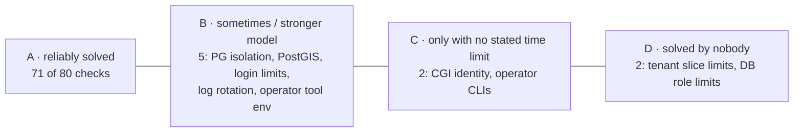

# Map of all checks: who gets them

Every check on the three core tasks, grouped by who solves it. Rows: `miss-map.csv`.

**Runs used:**
- Haiku: final timed k=3.
- Opus 5.5: node17 only, n=1, same verifier.
- Sonnet 5.5: n=1 on node17 and node31, on an earlier verifier revision (node31's had no `operator_tools`).
- Haiku no-clock ablation: n=1 on node17 and node31.

| Group | Meaning | node17 (35) | node31 (27) | node37 (18) |
|---|---|---|---|---|
| **A. Reliably solved** | Haiku ≥ 2/3 timed, and Opus too where run | 28 | 26 | 17 |
| **B. Sometimes / stronger model** | Haiku 1/3, or solved by Sonnet/Opus, or Haiku solves it but Opus doesn't | 4 | 0 | 1 |
| **C. Only without a stated time limit** | Solved by no timed run; solved by the no-clock Haiku run | 1 | 1 | 0 |
| **D. Solved by none** | No model, no variant | 2 | 0 | 0 |

**Groups B-D by name:**
- **node17:**
  - B: `postgres_isolation` (Sonnet only), `postgis` (Haiku 3/3, Opus ✗), `login_limits` and `log_rotation` (Sonnet; Haiku no-clock);
  - C: `cgi_identity`;
  - D: `slice_limits`, `db_role_limits`.
- **node31:** C: `operator_tools` (no timed Haiku trial; the no-clock run got it; Sonnet's verifier lacked the check).
- **node37:** B: `tool_env` (Haiku 1/3).

**Reading:**
- Almost everything is solved by somebody. The headroom is a thin tail of 9 of 80 checks, concentrated in mechanisms outside the obvious config tree: limits, DB catalog state, per-tenant identity, operator tooling.
- Group C is the notable one. Two items only appear when the agent isn't told its budget and keeps working.
- So for node31, the "capability gap" reading (`operator_tools`) needs softening: with no stated budget, Haiku found it (n=1). Its no-clock run still failed on `amtool_operator` and `host_identity`.
- Group D (`slice_limits`, `db_role_limits`) is what no model or variant got. Both are "invisible unless you query the running system": systemd slice properties, and `pg_roles.rolconnlimit`.
