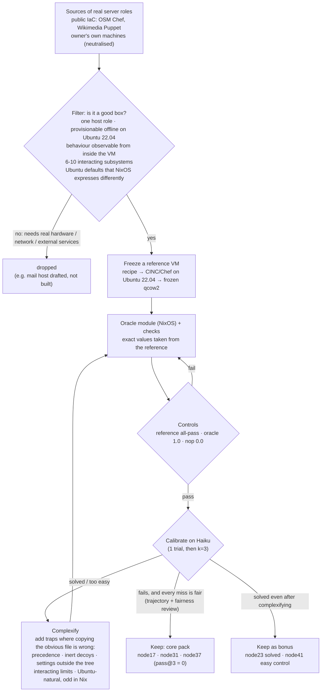
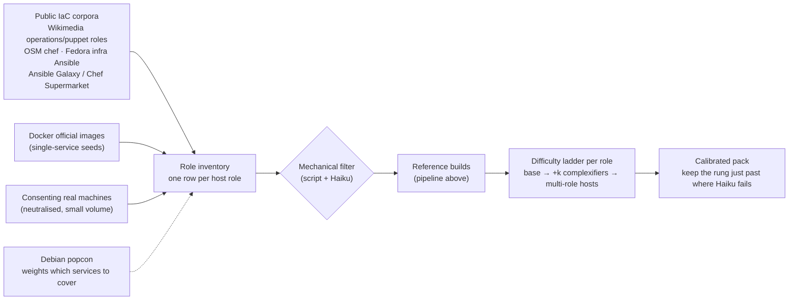

# How we found the boxes, complexified them, and how to find many more

## The funnel (what we actually did)

## What came out

| Box | Source | Subsystems | Checks (recipe + complexifier) | Haiku final k=3 | Where |
|---|---|---|---|---|---|
| node17 | OSM Chef dev/tenant host | web, PHP-FPM, CGI/WSGI, Postgres+PostGIS, MariaDB, cache, sudo, limits | 31 + 4 | 0/3 | core |
| node31 | Wikimedia Puppet monitoring role | Prometheus, Alertmanager, exporters, nginx, operator tools | 23 + 4 | 0/3 | core |
| node37 | owner's GPU box (neutralised) | kernel cmdline, sysctl, modprobe, udev, sleep, timers, pam_env | 14 + 4 | 0/3 | core |
| node23 | Wikimedia Puppet DNS role | dnsdist, pdns-recursor, nsd, DoT, sudo | 22 + 4 | 1/3 solved | bonus |
| node41 | owner's home file server | Samba, Btrfs RAID1 on USB disks, automount | 16 | 0.94 (k=1) | bonus |

**The pattern:** boxes whose state lives in a few config files (node23, node41) get solved. Boxes with state spread across mechanisms (limits, DB catalogs, per-tenant identity, kernel/udev, operator PATH) don't.

## How we'd find a lot more (the story for the scale plan)

- **Where the volume comes from:** one public Puppet/Chef/Ansible repo holds hundreds of host roles. Each role gives several tasks: a different complexifier mix, source distro, or nixpkgs pin. Rough sizing (to verify): ~200 roles × 5 variants ≈ 1,000 tasks.
- **Why it scales:** the recipe *is* the ground truth. The reference VM is built from it, so the spec never has to be written by hand. Checks are templated per daemon and filled from the running reference.
- **Where difficulty comes from:** not from making boxes bigger, but from the ladder. Add complexifiers until Haiku k=3 falls to 0, then keep that rung. The complexifier library is reusable across roles (7 implemented, 9 drafted; `author/complexify.md`).
- **What doesn't scale (be honest):**
  - the per-trial cost (KVM, a 4-8 min verifier build, large images);
  - the human fairness sign-off on new check templates;
  - roles that need real hardware or external services, which get filtered out.
