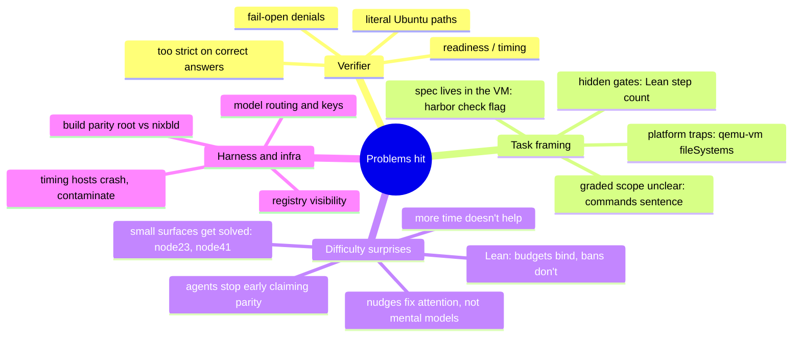

# Verifier fixes across all three attacks

Compiled by a read-only Sonnet pass (2026-11-04) over the project notes, the Claude Code transcripts (Nix, Lean) and git history.
Python transcripts exist only from 11-03 ~14:08 onward, so the earlier Python items come from that attack's notes. Times are PST, 11-02 to 11-03.

## Fixes (21, deduplicated)

| # | Attack | Task | Problem | Found by | Fix | Score effect |
|---|---|---|---|---|---|---|
| 1 | Nix | node17 | The first nop control crashed the verifier (hard-coded VM name) | nop control | Name parameterised | none (harness error) |
| 2 | Nix | node17 | `postgres_isolation` (and one other isolation check) failed open under nop: it expected only a denial, so a missing service passed | nop control | Every denial check also asserts the allowed path (rule in methods.md) | nop from non-zero to 0/31 |
| 3 | Nix | node17 | `log_rotation` parser bug | oracle control (0.97) | Parser fixed | oracle back to 1.0 |
| 4 | Nix | node17 | Build-user parity: the solving image built as root, so a read-only `/etc` store link passed locally and failed in the verifier. node23/node31 images were later found still building as root and rebuilt | Haiku r2 scored 0 after believing it was done | `nixbld` build users in the solving image + `check-tools` probe | r2's 0 invalid; later run 0.85 |
| 5 | Nix | node17 | Readiness: `Guest.ready()` returned at `multi-user.target` while boot jobs were still running | trajectory review → re-grade | Wait for an empty `systemctl list-jobs` (v2) | aVqPFzU 0.66 → 0.43: v1 was lenient (credited an httpd unit that never finishes starting). pass@3 unchanged |
| 6 | Nix | node37 | Four faults at the first controls: systemd `*USec` property names, `systemctl show` property order, NixOS `linked` vs Ubuntu `static`, a fail-open `cmdline_decoy` | reference 14/16, oracle 13/16 | Checks rewritten to test behaviour | ref 16/16, oracle 1.0, nop 0/16 |
| 7 | Nix | node37 | `module_policy` required the literal `/bin/false`, which NixOS lacks | review of a Haiku submission | Accept any `*/false` | Haiku 0.875 → 0.94 on re-grade |
| 8 | Nix | node37 | `udev_i2c` read only `/etc/udev/rules.d` and one exact rule line | Sonnet verifier audit | Read the files `udevadm test` loads; accept any equivalent rule | none observed |
| 9 | Nix | node23 | `listeners` keyed `ss` rows by (proto, port), so `[::1]` overwrote `127.0.0.1` | audit | Sets per port; loopback services may bind only loopback | none observed |
| 10 | Nix | node23 | `sudo_policy` denial used `/usr/bin/id` (absent on NixOS), so any sudo grant passed (fail-open) | audit | Denial runs `/bin/sh -c true` | none observed |
| 11 | Nix | node31 | `listeners`: same overwrite as #9 | audit | Same as #9 | none observed |
| 12 | Nix | node31 | `textfile_timer` required the reference's unit name | audit | Accept any `.timer` with matching `OnBootUSec` / `OnUnitActiveUSec` | none observed |
| 13 | Nix | node17 | `/usr/bin/python3` CGI shebang convention was undiscoverable | Sonnet fairness review | Seeded `cgi-bin/hello.py`; `log_rotation` loosened | not quantified |
| 14 | Nix | node41 | Harness trap: the qemu-vm module replaces `fileSystems` (two fix rounds) | controls | Prompt states `virtualisation.fileSystems` | controls clean |
| 15 | Nix | node31 | The oracle lacked `promtool` when `operator_tools` was added | oracle control | Oracle adds `prometheus.cli` | n/a |
| 16 | Lean | all | Python text comparison of the theorem statement rejected valid proofs starting with `using` / `unfolding` / `including` | LLM review of risks.md; confirmed with the oracle plus `using assms` | Text comparison removed; `Check.thy` still compares terms | none (fixed before the final runs) |
| 17 | Lean | Cauchy open-book | The comment/cartouche parser stopped at the first closing bracket, so "axioms" in a nested `text ‹…›` tripped the forbidden-token gate | subagent audit of the k3 trials | Depth-counting scrub; strings and prose no longer scanned | none (that trial failed for other reasons too) |
| 18 | Lean | all | `meson` not banned (a hole in the ban); Isabelle thread pool not capped at the 2-CPU quota | LLM review | `meson` banned (later allowed with `metis`); `-o threads=2` | none |
| 19 | Lean | quantum | Hidden gate: the verifier required at least 4 Isar steps; the prompt didn't say so | ship-shape review | Prompt states the gate | none |
| 20 | Python | early 7-task suite | Verifier defect (`ValueError: Forbidden name: __slots__`) failed two Haiku trials | first Haiku run | Suite retired; verifier rebuilt | 2 of 5 zeros were verifier errors |
| 21 | Python | sympy, lark | Timing/limits, six faults: (a) result-encoding cost not subtracted (~85 ms fixed serial cost); (b) cache shared across samples; (c) scaling limits failed the oracle; (d) the oracle used a forbidden `ctypes` trick; (e) an oracle run overlapped a pytest and scored 0; (f) inputs too short (50-100 ms) | oracle control, author/owner inspection | Six fixes: encode subtraction, fresh process per sample, per-doubling step bars (1.10/1.05), `ctypes` removed, forest row dropped, 70-74-operand inputs with a stated ~100 ms minimum, quiet host | oracle 0 → 1.0 on both; margins 5-30% |

## Why: reason taxonomy (approximate; #5 counts in two)

| Category | Count | Nix / Lean / Python |
|---|---|---|
| Brittle or over-strict: a correct answer fails (literal paths and names, exact lines, overwrite, text compare, parser) | 9 | 6 / 3 / 0 |
| Fail-open: nop or a wrong answer passes | 4 | 4 / 0 / 0 |
| Environment or timing parity (build users, readiness, noisy host, encode cost) | 4 | 2 / 0 / 2 |
| Harness crash or oracle bug | 4 | 3 / 0 / 1 |
| Calibration (limits fail the oracle; the oracle breaks the rules) | 2 | 0 / 0 / 2 |
| Prompt/verifier mismatch or undiscoverable requirement | 2 | 1 / 1 / 0 |
| Inputs too short to time | 1 | 0 / 0 / 1 |

Not counted as verifier fixes:
- Lean `harbor check` flagged the shipped Lean proof as an answer key. It was handled with a paper-PDF variant (11/11 harbor check).
- A Lark `behavior_in_tests` flag led to a prompt fix.

## Found by

| QA step | Count | Catches |
|---|---|---|
| oracle / reference / nop controls | 9 | crashes, fail-opens, calibration |
| LLM review or audit (Sonnet) | 8 | brittle and over-strict checks, which controls never expose |
| author / owner inspection | 3 | timing design |
| model-run failure | 2 | environment-parity bugs that no control can show |
| re-grade after trajectory review | 1 | lenient readiness |
| subagent audit of Haiku runs | 1 | parser edge case |

## Takeaways for a scale-up QA loop
1. **Controls first.** Run oracle and nop before any model run, and treat every score below 1.0 before the controls pass as a harness fault. In Nix, six runs went by before the zeros were separated from task failures.
2. **Add a reference-vs-oracle control and a read-only LLM audit with a fixed checklist:** literal paths, unit and process names, output formats, fixed globs, fail-open denials. It is the only step that catches over-strict checks, the largest category.
3. **Make the solving environment identical to the grader:** build users, boot readiness, a quiet timing host. The worst unfair failure is a green local build that the verifier rejects.
4. **Re-grade the same submissions under each new verifier version, and keep a ledger.** That caught a lenient verifier (0.66 → 0.43) that a trajectory review had misread as flaky.
5. **Pair every denial check with an allowed-path check.** Nop catches fail-open checks only if there is something to deny.

## Gaps
- **Python:** transcripts exist only from 11-03 ~14:08 onward (not searched in this pass); earlier items come from timeline/WRAPUP/handoff. #20 has no recorded cause, and the 11-02 nop reviews and 14:21-17:09 fixes aren't itemised anywhere.
- **Nix #2:** the second fail-open isolation check is unnamed in the notes.
- **Unconfirmed:** whether `acl_client_networks` (a fail-open gap noted in the 11-04 node23 review) was implemented. `hosts_file` was judged unimportant and not fixed.
- **Known Python weaknesses, recorded but not fixed:** racy code can pass the hidden cases (trial CMuVNu4); numeric ratios are missing on early exit; the Lark scope sentence is stale.
- **Excluded:** Lean oracle and trusted-base bugs (Cauchy `fix` naming, a looping lemma, Shor `periodic_state` / `recover`), since they aren't grader fixes.

## Problem map beyond the verifier

All problems we hit, grouped: verifier, task framing, difficulty surprises, harness/infra. One row per problem: `author/report-figures/problem-map.csv`.

